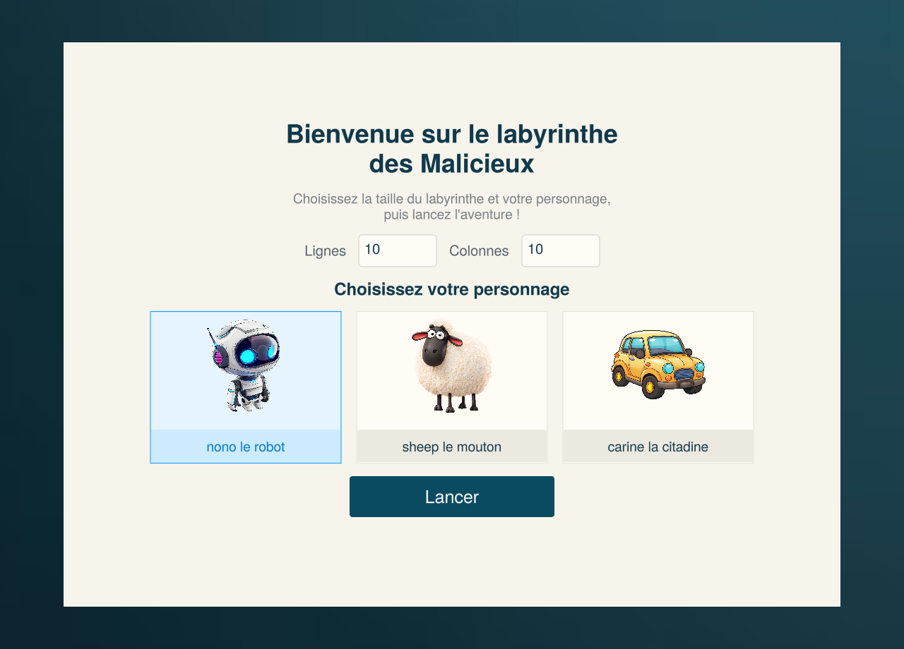
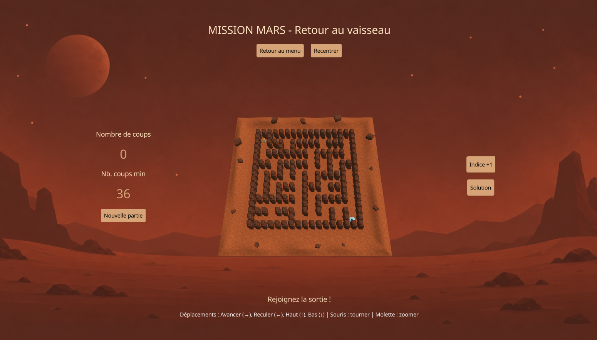
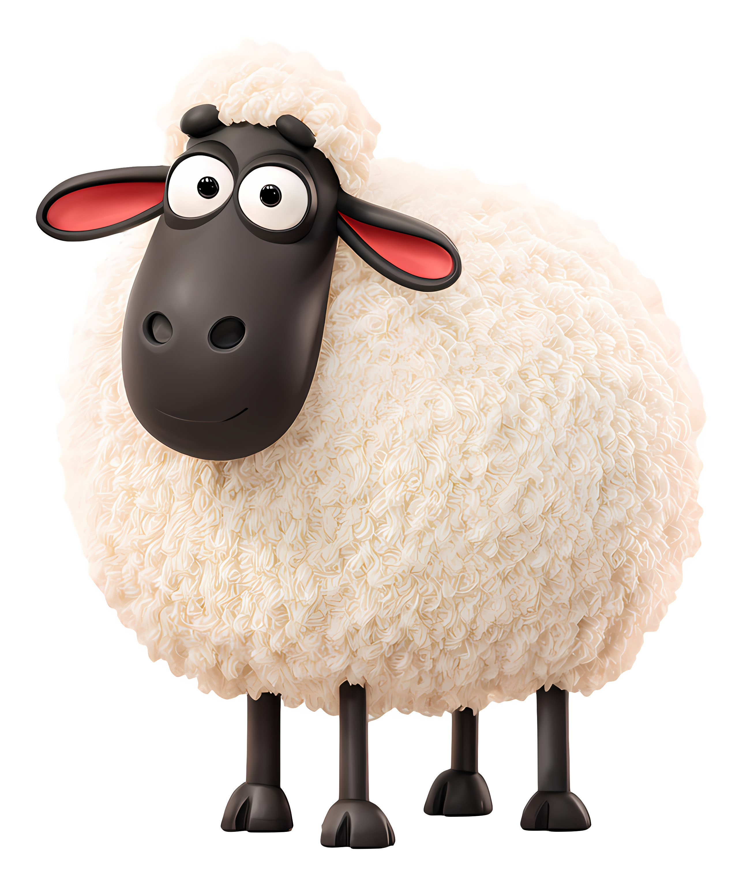
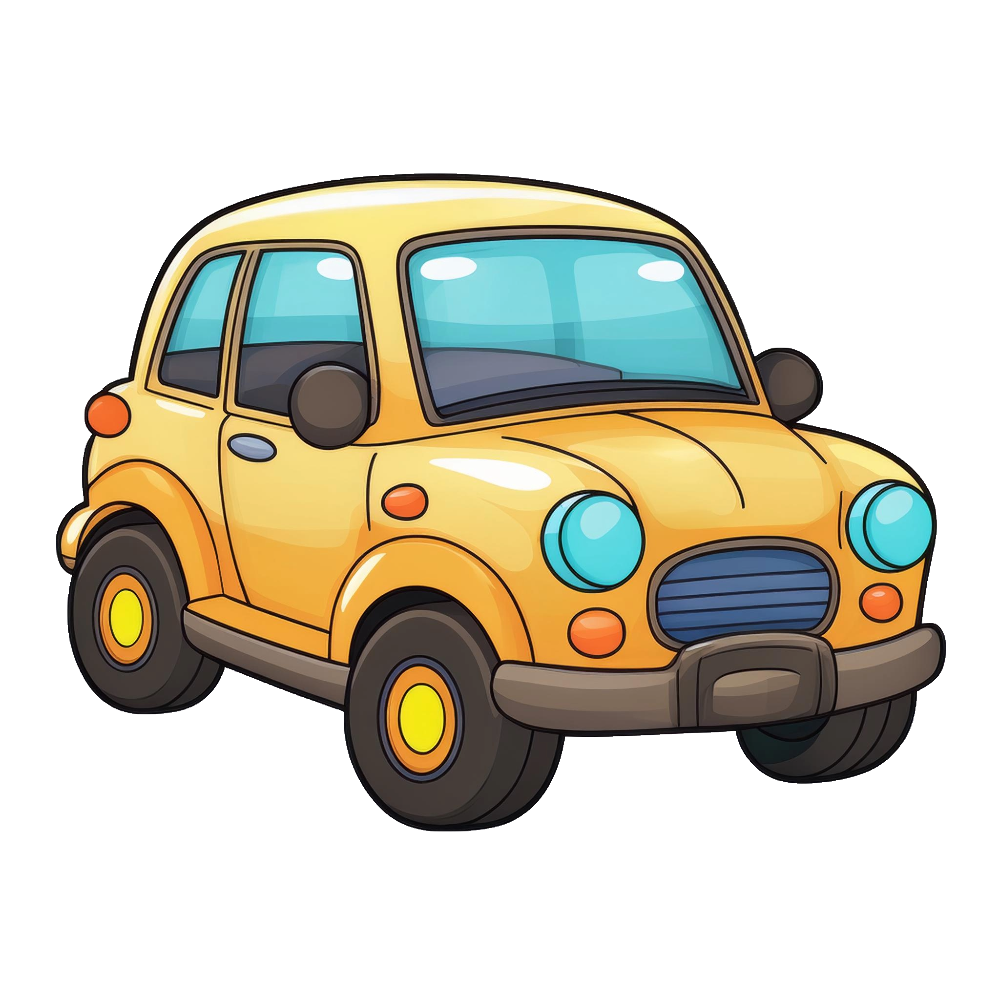
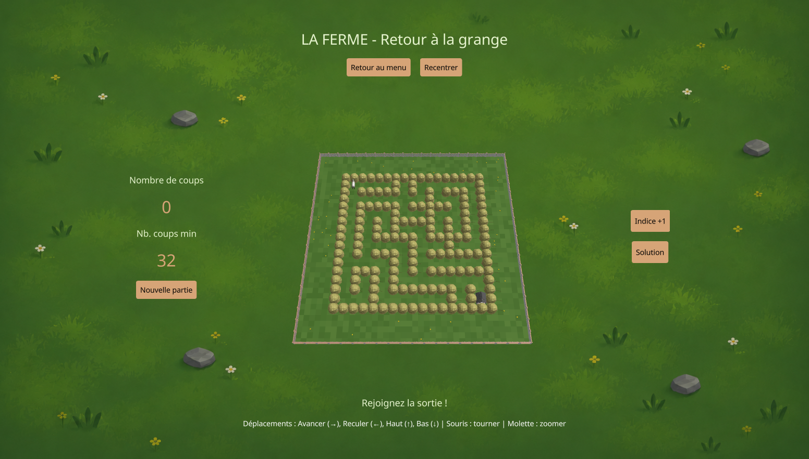
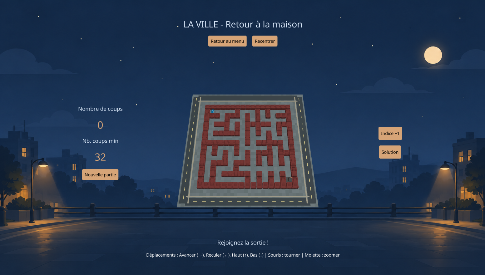

<!-- LES FONCTIONS CI-DESSOUS SERVENT A GENERER LES ILLUSTRATIONS ET ANIMATIONS DU LABYRINTHE, NOTAMMENT POUR LES ALGORITHMES DE KRUSKAL ET BFS.
LE RAPPORT COMMENCE PLUS BAS, LIGNE 355 JUSQU'A LA LIGNE 891.
-->


```{julia}
#| label: preparation-visuels
#| include: false

# Ces fonctions servent seulement aux illustrations du rapport.
# Les fonctions du package Labyrinthe restent inchangées.
using Labyrinthe
using Random
using DataStructures

function grille_svg(grille; visites=Tuple{Int,Int}[], chemin=Tuple{Int,Int}[], position=nothing)
    lignes, colonnes = size(grille)
    cote = 36
    couleurs = ["#f7f4eb", "#263c49", "#007f82", "#dc932e"]

    svg = "<svg xmlns='http://www.w3.org/2000/svg' viewBox='0 0 $(colonnes*cote) $(lignes*cote)' role='img' aria-label='Grille du labyrinthe' style='display:block;width:100%;max-width:480px;margin:auto;'>"

    for ligne in 1:lignes
        for colonne in 1:colonnes
            valeur = grille[ligne, colonne]
            couleur = couleurs[valeur + 1]

            if valeur == 0 && (ligne, colonne) in visites
                couleur = "#bce3f3"
            end

            if valeur == 0 && (ligne, colonne) in chemin
                couleur = "#f6c86c"
            end

            x = (colonne - 1) * cote
            y = (ligne - 1) * cote

            svg *= "<rect x='$x' y='$y' width='$cote' height='$cote' fill='$couleur' stroke='white' stroke-width='1.5'/>"

            if valeur == 2 || valeur == 3
                if valeur == 2
                    lettre = "P"
                else
                    lettre = "A"
                end

                svg *= "<text x='$(x+cote/2)' y='$(y+cote/2+1)' fill='white' text-anchor='middle' dominant-baseline='middle' font-family='Arial,sans-serif' font-size='17' font-weight='bold'>$lettre</text>"
            end

            if position == (ligne, colonne)
                svg *= "<rect x='$(x+3)' y='$(y+3)' width='$(cote-6)' height='$(cote-6)' fill='none' stroke='#0064b5' stroke-width='3' rx='3'/>"
            end
        end
    end

    return svg * "</svg>"
end


function afficher_grille(grille; kwargs...)
    display(HTML(grille_svg(grille; kwargs...)))
    return nothing
end


# Affichage des étapes avec les boutons précédent et suivant
function afficher_etapes(etapes, titre)
    nombre = length(etapes)

    html = "<section class='demo-lab' aria-label='$titre'>"
    html *= "<p class='demo-title'>$titre</p>"

    html *= "<div class='demo-controls'>"
    html *= "<button type='button' data-sens='-1' aria-label='Étape précédente'>Précédent</button>"
    html *= "<input type='range' min='1' max='$nombre' value='1' aria-label='Choisir une étape'>"
    html *= "<button type='button' data-sens='1' aria-label='Étape suivante'>Suivant</button>"
    html *= "<span class='demo-compteur' aria-live='polite'>Étape 1 / $nombre</span>"
    html *= "</div>"

    for (i, (svg, texte)) in enumerate(etapes)
        if i == 1
            masque = ""
        else
            masque = " hidden"
        end

        html *= "<div class='demo-etape'$masque>"
        html *= svg
        html *= "<p class='demo-note'>$texte</p>"
        html *= "</div>"
    end

    html *= "<p class='demo-legende'><span style='color:#263c49'>■</span> Obstacle - P : personnage - A : arrivée - Bleu clair : découvert - Jaune : chemin</p>"
    html *= "</section>"

    display(HTML(html))
    return nothing
end


# Illustration de la génération du labyrinthe avec Kruskal
function illustration_kruskal(lignes, colonnes)
    grille = ones(Int, 2 * lignes + 1, 2 * colonnes + 1)
    ensembles = IntDisjointSet(lignes * colonnes)

    numero(x, y) = (y - 1) * colonnes + x

    # Création des cellules
    for y in 1:lignes
        for x in 1:colonnes
            grille[2 * y, 2 * x] = 0
        end
    end

    # Liste des murs entre les cellules
    murs = Tuple{Tuple{Int,Int},Tuple{Int,Int}}[]

    for y in 1:lignes
        for x in 1:colonnes
            if x < colonnes
                push!(murs, ((x, y), (x + 1, y)))
            end

            if y < lignes
                push!(murs, ((x, y), (x, y + 1)))
            end
        end
    end

    shuffle!(murs)

    etapes = [
        (grille_svg(grille), "Au départ, les $(lignes * colonnes) cellules sont isolées.")
    ]

    passages = 0

    # Ouverture des murs sans créer de cycle
    for ((x1, y1), (x2, y2)) in murs
        i1 = numero(x1, y1)
        i2 = numero(x2, y2)

        mur = (y1 + y2, x1 + x2)

        if !in_same_set(ensembles, i1, i2)
            union!(ensembles, i1, i2)
            grille[mur...] = 0
            passages += 1

            texte = "Mur $(mur) retiré : deux ensembles sont réunis. Passages ouverts : $passages."
        else
            texte = "Mur $(mur) conservé : les cellules sont déjà reliées. L'ouvrir créerait un cycle."
        end

        push!(etapes, (grille_svg(grille; position=mur), texte))
    end

    # Placement du départ et de l'arrivée
    grille[2, 2] = 2
    grille[2 * lignes, 2 * colonnes] = 3

    texte = "Labyrinthe terminé : $passages passages relient $(lignes * colonnes) cellules. Le départ et l'arrivée sont placés."
    push!(etapes, (grille_svg(grille), texte))

    return etapes, grille
end


# Illustration de la recherche du chemin avec BFS
function illustration_bfs(grille, depart, arrivee)
    lignes, colonnes = size(grille)

    file = [depart]
    visites = [depart]

    distances = fill(-1, lignes, colonnes)
    distances[depart...] = 0

    etapes = [
        (grille_svg(grille; position=depart), "BFS commence au départ, à distance 0.")
    ]

    # Exploration des cases
    while !isempty(file)
        ligne, colonne = popfirst!(file)
        position = (ligne, colonne)

        if position == arrivee
            break
        end

        voisins = [
            (ligne - 1, colonne),
            (ligne + 1, colonne),
            (ligne, colonne - 1),
            (ligne, colonne + 1)
        ]

        for (l, c) in voisins
            if 1 <= l <= lignes && 1 <= c <= colonnes
                if grille[l, c] != 1 && distances[l, c] == -1
                    distances[l, c] = distances[ligne, colonne] + 1

                    push!(file, (l, c))
                    push!(visites, (l, c))
                end
            end
        end

        texte = "Case $(position) explorée à distance $(distances[position...]). $(length(file)) case(s) restent dans la file."
        push!(etapes, (grille_svg(grille; visites=visites, position=position), texte))
    end

    # Affichage du chemin optimal
    chemin = optimalpath(grille, depart, arrivee)
    @assert distances[arrivee...] == length(chemin) - 1
    texte = "Arrivée atteinte. Le chemin optimal contient $(length(chemin)) cases, soit $(length(chemin) - 1) déplacements."
    push!(etapes, (grille_svg(grille; visites=visites, chemin=chemin), texte))
    return etapes
end

```


<!-- DEBUT DU RAPPORT -->

# Présentation du projet

Le **Labyrinthe des Malicieux** est un jeu que nous avons développé en Julia. Le joueur choisit les dimensions du labyrinthe et son personnage, et utilise ensuite les flèches du clavier pour contourner les obstacles et rejoindre l’arrivée.

Nous avons commencé par une grille de nombres pour tester les déplacements. Une fois cette étape terminée, nous avons utilisé **Kruskal** pour générer les labyrinthes et **BFS** pour calculer le chemin le plus court. Nous avons ensuite créé une interface 3D pour le navigateur et organisé le code en un **package Julia**, avec des structures, plusieurs fichiers et des tests.

Le joueur peut choisir entre trois univers qui suivent les mêmes règles. Un compteur indique le nombre de déplacements et deux aides permettent de suivre tout ou partie du trajet jusqu’à l’arrivée.

| Univers | Personnage | Objectif | Obstacles |
|---|---|---|---|
| Mars | Nono le robot | Rejoindre le vaisseau | Rochers |
| Ferme | Sheep le mouton | Rejoindre la grange | Bottes de foin |
| Ville | Carine la citadine | Rejoindre la maison | Murets |

{#fig-menu width=95% .lightbox}


## Pourquoi Julia ?

Julia nous a servi à écrire les algorithmes, à construire l’interface et à exécuter les exemples du rapport. Nous avons ainsi appliqué le principe **"one language"** abordé en cours.

Le **typage dynamique** nous permet d’écrire des fonctions sans annoter tous leurs arguments. Julia utilise aussi la **compilation JIT** (*Just In Time*) pour optimiser leur exécution. 

Lors du premier lancement du jeu, nous avons constaté que le chargement des packages et la compilation pouvaient prendre du temps.


# La grille et les déplacements

## Représenter le jeu

Notre première grille était petite et fixe, ce qui nous permettait de prévoir les déplacements possibles avant de tester le code. Nous l’avons représentée par **une matrice d’entiers**.

| Valeur | Élément du jeu |
| ------ | -------------- |
| `0` | Case libre sur laquelle le personnage peut avancer |
| `1` | Mur qui bloque le passage |
| `2` | Position du personnage |
| `3` | Arrivée, y compris lorsque le personnage l’occupe |

Les trois univers utilisent ce même codage. Seul l'affichage change selon le personnage et le décor choisis.

Voici un exemple de grille :

```julia
grid = [1 1 1 1 1;
        1 2 0 0 1;
        1 1 1 0 1;
        1 1 1 3 1;
        1 1 1 1 1]

position = (2, 2)
```

La grille est une `Matrix{Int}`. La position du personnage est un `Tuple{Int, Int}` qui contient sa ligne et sa colonne. 

C’est ainsi que nous avons utilisé les **tableaux** et les **tuples** vus en cours.

En Julia, les indices commencent à `1`. Dans notre exemple, `grid[2, 2]` désigne la case de départ. Cette écriture appelle `getindex` pour lire une valeur et `setindex!` lors d’une affectation.


## Autoriser ou refuser un déplacement

Une fois la grille créée, nous avons développé la fonction `applymove!` pour gérer les déplacements du personnage.

`applymove!` reçoit la grille, la position actuelle et l’une des quatre directions `:up`, `:down`, `:left` ou `:right`. Chacune est une valeur de type `Symbol`.

La fonction calcule les coordonnées de la case suivante :

- **Si elle sort de la grille ou correspond à un mur**, la fonction renvoie la position actuelle et le compteur reste au même total.
- **Si la case est accessible**, la fonction libère l’ancienne case et renvoie la nouvelle position.

La case d’arrivée garde la valeur `3` lorsque le personnage l’atteint.

Pour avancer vers la droite, nous appelons la fonction ainsi.

```julia
position = applymove!(grid, position, :right)
```

En Julia, le suffixe `!` signale par **convention** qu’une fonction peut modifier l’un de ses arguments. Ici, `applymove!` modifie directement la grille.


## Voir le résultat

Dans la démonstration sur la grille fixe, le personnage part de `(2, 2)`. Un essai contre un mur laisse le compteur au même total.
Il faut ensuite avancer deux fois vers la droite et deux fois vers le bas pour atteindre `(4, 4)`, soit **quatre déplacements** comptabilisés.

```{julia}
#| label: demonstration-deplacements
#| echo: false
grille_deplacement = [1 1 1 1 1;
                     1 2 0 0 1;
                     1 1 1 0 1;
                     1 1 1 3 1;
                     1 1 1 1 1]
let grille = copy(grille_deplacement), position = (2, 2), coups = 0
    etapes = [(grille_svg(grille; position=position), "Départ en (2, 2). Compteur : 0.")]
    for direction in [:up, :right, :right, :down, :down]
        precedente = position
        position = applymove!(grille, position, direction)
        if position != precedente
            coups += 1
            explication = "Direction $(direction) : déplacement autorisé vers $(position). Compteur : $coups."
        else
            explication = "Direction $(direction) : un obstacle bloque le déplacement. Compteur inchangé : $coups."
        end
        push!(etapes, (grille_svg(grille; position=position), explication))
    end
    @assert position == (4, 4) && coups == 4 && grille[4, 4] == 3
    afficher_etapes(etapes, "Déplacements : un mur puis quatre coups jusqu'à l'arrivée")
end
```

Les boutons de la démonstration parcourent les étapes calculées avec la fonction du package lors de la génération du rapport. On peut donc les utiliser dans le fichier HTML sans lancer de serveur Julia.


# Générer le labyrinthe avec Kruskal

La grille fixe nous a permis de vérifier les déplacements. Pour varier les labyrinthes d’une partie à l’autre, nous avons utilisé une version de **l’algorithme de Kruskal** dans `generategrid(rows, cols)`.
Il choisit dans un ordre aléatoire quels murs ouvrir pour relier toutes les cellules sans créer de boucle. 

Il existe ainsi **un seul chemin entre deux cellules du labyrinthe**.


## Construire les passages

Nous partons d’une matrice remplie de `1`. Les boucles `for` parcourent les intervalles `1:rows` et `1:cols`, qui sont des itérables, pour placer les cellules libres (`0`) aux coordonnées paires.
La matrice doit être plus grande que le nombre de cellules demandé pour accueillir les murs intérieurs et les bordures.

```julia
grid = ones(Int, 2rows + 1, 2cols + 1)
for y in 1:rows, x in 1:cols
    grid[2y, 2x] = 0
end
```

Nous relevons les murs qui séparent deux cellules voisines, puis nous mélangeons leur ordre avec `shuffle!`.
Pour savoir quelles cellules sont déjà reliées, nous utilisons `IntDisjointSet` du package `DataStructures`.
Au départ, chaque cellule forme son propre groupe.

Nous examinons les murs un par un :

- **Si les deux cellules de part et d’autre sont dans des groupes différents**, nous ouvrons le passage et réunissons les groupes avec `union!`.
- **Si elles appartiennent au même groupe**, un chemin existe déjà entre elles. Nous gardons alors le mur pour éviter une boucle.

Nous poursuivons jusqu’à ce que toutes les cellules soient reliées.


## Un exemple reproductible

Pour retrouver le labyrinthe de la démonstration dans le même environnement Julia, nous fixons une graine aléatoire. Cette graine est propre à l’exemple du rapport.

```{julia}
using Labyrinthe
using Random

Random.seed!(42)
grille_exemple = generategrid(3, 4)
afficher_grille(grille_exemple)
```

La démonstration reprend l’algorithme pour enregistrer les murs ouverts ou conservés à chaque étape. Nous comparons sa grille finale à celle que produit `generategrid`.

```{julia}
#| label: demonstration-kruskal
#| echo: false
Random.seed!(42)
etapes_kruskal, grille_illustree = illustration_kruskal(3, 4)
@assert grille_illustree == grille_exemple
afficher_etapes(etapes_kruskal, "Kruskal : ouvrir un passage ou conserver un mur")
```


# Trouver le chemin optimal avec BFS

`optimalpath(grid, start, goal)` utilise **BFS** (*Breadth-First Search*), ou **parcours en largeur**, pour trouver le trajet jusqu’à l’arrivée.

L’algorithme explore d’abord les cases accessibles en un coup, puis en deux, et ainsi de suite.
Comme chaque déplacement compte pour un coup, **le premier chemin trouvé est le plus court.**


## Explorer puis reconstruire

Nous plaçons la case de départ dans une **file**. À chaque étape, `popfirst!` retire la première case. Nous examinons ses voisins en haut, en bas, à gauche et à droite.

- **Si un voisin est un mur ou a déjà été visité**, nous l'ignorons.
- **Si le voisin est accessible et n'a pas encore été visité**, nous l'ajoutons à la fin de la file avec `push!`.

Pour chaque case découverte, la matrice `previous` mémorise la position d’où nous venons. Lorsque BFS atteint l’arrivée, nous suivons ces positions en sens inverse jusqu’au départ.

Avec `pushfirst!`, chaque position est insérée au début du vecteur, si bien que le trajet final se lit du départ à l’arrivée.

```julia
path = Tuple{Int, Int}[]
```

Cette instruction crée un **vecteur vide** de coordonnées. Le **type paramétré** `Tuple{Int, Int}` précise que chaque position contient deux entiers, pour la ligne et la colonne.

Puisque Kruskal relie toutes les cellules, BFS peut toujours trouver un trajet depuis la position du personnage.


## Résultat et aides du jeu

```{julia}
nrows, ncols = size(grille_exemple)
depart = (2, 2)
arrivee = (nrows - 1, ncols - 1)
chemin_exemple = optimalpath(grille_exemple, depart, arrivee)

println("Chemin : ", chemin_exemple)
println("Minimum de déplacements : ", optimalmoves(grille_exemple, depart, arrivee))
```

Un chemin contenant `n` cases correspond à `n - 1` déplacements : le minimum vaut donc `length(path) - 1`. Dans la démonstration, le bleu clair indique les cases découvertes et le jaune le chemin final renvoyé par `optimalpath`.

```{julia}
#| label: demonstration-bfs
#| echo: false
afficher_etapes(illustration_bfs(grille_exemple, depart, arrivee), "BFS : des cases découvertes au chemin optimal")
```


## Les aides du jeu

Nous avons réutilisé le calcul du chemin optimal pour proposer deux aides au joueur :

- **Solution** affiche ou masque le chemin calculé par BFS depuis la position actuelle.
- **Indice +1** utilise ce même trajet pour faire avancer le personnage d’une case et ajouter un coup au compteur.


# Passer à une interface web

## De GLMakie au navigateur

Notre première interface tournait dans une fenêtre GLMakie. Nous sommes passés à **WGLMakie** pour afficher la 3D dans le navigateur, avec **Bonito** pour construire la page et communiquer avec Julia.

Comme le calcul et l’affichage étaient séparés, nous avons pu reprendre la grille, les déplacements et les algorithmes dans la nouvelle interface.

`drawmaze` construit l’écran et `drawmaze!` place les objets dans la scène. Les compteurs sont à gauche, les aides à droite et les commandes en bas.

{#fig-interface width=100% .lightbox}


## Réagir aux actions du joueur

Les boutons et le clavier déclenchent des fonctions. Le bouton d’indice appelle par exemple `hint!` à chaque clic.

```julia
on(hintbutton.clicks) do _
    hint!()
end
```

Le bloc `do` fournit à `on` la fonction à appeler. Les fonctions locales comme `hint!` et `refresh!` ont accès aux données de la partie, ce qui permet aux boutons d’agir sur son état.

Les **Observables** permettent de mettre à jour une information sans reconstruire toute l’interface. Pour actualiser le compteur, nous convertissons le nombre de coups en texte et l’affectons à `movelabel.text[]`.

```julia
movelabel.text[] = string(state.moves)
```

Le joueur peut aussi déplacer la caméra avec la souris, régler le zoom avec la molette et recentrer la vue.


## Du menu au jeu, puis au menu

Le menu vérifie le personnage et les dimensions choisis avant de lancer la partie. La valeur observable `page` indique quel écran afficher. 
Au retour à l’accueil, le menu retrouve le dernier personnage et les dernières dimensions sélectionnés.

Les choix passent du menu au jeu par un **`Channel`** de Julia.

```julia
Channel{Tuple{Int,Int,String}}
```

Le tuple contient le nombre de lignes, le nombre de colonnes et le nom du personnage. Une **tâche asynchrone**, lancée avec `@async` récupère ces valeurs et crée la partie sans bloquer le menu pendant l’attente.


# Les trois univers et leurs modèles

**Mars, la ferme et la ville** ont chacun leur personnage, leurs obstacles et leur décor. 
Le **dictionnaire** `MODES` associe chaque personnage à un `DisplayTheme` qui contient le titre, les modèles 3D et le fond à afficher.

Les fichiers **OBJ** décrivent la forme des modèles, et les fichiers **MTL** ainsi que les textures définissent leurs couleurs et leur apparence. 
Les modèles sont rangés dans `models/mars`, `models/prairie` pour la ferme et `models/ville`, tandis que les fonds se trouvent dans `models/fonds` et les images du menu dans `models/menu`.

Nous avons réglé la taille et l’orientation des modèles pour les adapter à la grille. 
À l’affichage, chaque mur prend la forme d’un obstacle du thème choisi ; le personnage et l’arrivée sont placés aux coordonnées indiquées par le jeu.

Les trois personnages sont sélectionnables dans le menu.

::: {layout-ncol=3}

{width=90% .lightbox}

{width=90% .lightbox}

{width=90% .lightbox}

:::


# Difficultés et corrections

Pendant le développement du jeu, nous avons rencontré plusieurs problèmes, notamment avec l'affichage 3D et les performances.

Dans la ferme, les nombreuses bottes de foin ralentissaient l’affichage. Nous avons allégé certains modèles et limité les dimensions proposées dans le menu.

Les essais dans les trois univers nous ont aussi permis de repérer les problèmes suivants :

| Difficulté rencontrée | Correction |
| --------------------- | ---------- |
| Certains personnages étaient mal orientés ou peu visibles | Ajustement de leur taille et de leur orientation selon les déplacements |
| Le lancement d’une nouvelle partie était lent | Réutilisation des obstacles déjà affichés |
| Certaines lettres s’affichaient mal | Adoption de la police Noto Sans |
| Les choix étaient perdus au retour au menu | Conservation du dernier personnage et des dernières dimensions |

Pour accélérer le lancement d’une partie, nous déplaçons les obstacles déjà présents dans la scène au lieu de les recréer.

A dimensions égales, Kruskal ouvre toujours le même nombre de passages. La disposition change, mais le nombre d’obstacles reste identique.

Certains chemins vers les modèles 3D dépendaient au départ de l’emplacement du projet sur notre ordinateur. 

Pour éviter ce problème, nous avons utilisé des **chemins relatifs** :

```julia
const MODELS = normpath(joinpath(@__DIR__, "..", "models"))
```

La **macro** `@__DIR__` récupère le dossier du fichier Julia. `joinpath` construit ensuite le chemin vers `models` et `normpath` le normalise.
Le projet peut ainsi être déplacé sur un autre ordinateur sans modifier ces chemins à la main.


# Vérifier les fonctions avec des tests

Les **tests unitaires** de `test/runtests.jl` couvrent les déplacements, la génération du labyrinthe et la recherche du chemin optimal. Ils servent aussi à vérifier ces comportements après une modification du code. 

Dans le module `Test`, **`@test`** vérifie une condition et **`@testset`** rassemble les tests portant sur une même fonction.

Nous avons organisé nos **45 tests** en six groupes :

| Groupe | Ce que nous vérifions | Nombre de tests |
|---|---|---:|
| `Maze` | Les dimensions et la taille de la grille | 3 |
| `isoutside` | Les positions situées dans la grille ou en dehors | 4 |
| `applymove!` | Les déplacements, les collisions et la conservation de l'arrivée | 12 |
| `generategrid` | Les dimensions, le départ, l'arrivée et les bordures | 7 |
| `optimalpath` | Les chemins trouvés, leur validité et les cas particuliers comme une arrivée inaccessible | 16 |
| `optimalmoves` | Le nombre minimal de déplacements depuis différentes positions | 3 |

Pour tester les déplacements et BFS, nous partons d’une petite grille fixe créée avec `testmaze()`.
Nous connaissons déjà les coups possibles et le trajet attendu, ce qui nous permet de les comparer aux résultats du code.
Pour Kruskal, nous vérifions les dimensions, la position du départ et de l’arrivée, ainsi que les bordures.

Le test suivant contrôle la première ligne de la grille :

```julia
@test all(grid[1, :] .== 1)
```

L’opérateur `.==` compare chaque case à `1` par **broadcasting**. `all` vérifie que toutes les comparaisons sont vraies.

Nous exécutons les tests pendant la génération du rapport.

```{julia}
include("test/runtests.jl");
```

**Les 45 tests ont réussi**.

Ces tests vérifient principalement la logique du jeu. Nous avons donc aussi testé manuellement l'interface, les personnages, les interactions et l'affichage 3D.

Enfin, nous pourrions encore améliorer nos tests en vérifiant automatiquement que toutes les cellules d'un labyrinthe généré par Kruskal sont bien accessibles depuis le départ.


# Un package Julia modulaire et reproductible

## Organiser le code

Nous avons réparti le code en plusieurs fichiers au sein du **package `Labyrinthe`**. La commande `using Labyrinthe` permet de charger les mêmes fonctions dans le jeu, les tests et le rapport.

| Fichier | Responsabilité |
|---|---|
| `src/Labyrinthe.jl` | Module, chargement des fichiers et exports |
| `src/structure.jl` | Structures, génération de la grille et déplacements |
| `src/jeu.jl` | Chemin optimal, minimum de coups et point d'entrée `play` |
| `src/interface.jl` | Scène 3D et actions pendant la partie |
| `src/interface_web.jl` | Menu et navigation entre les écrans |
| `test/runtests.jl` | Tests unitaires |

Le **module** `Labyrinthe` réunit les fonctions et les types du package. Nous chargeons les fichiers avec `include` et choisissons les noms accessibles après `using Labyrinthe` avec `export`. Les fichiers ont des responsabilités distinctes, mais participent au même module principal.

## Structurer les données et utiliser les types

| Structure | Données regroupées | Choix |
|---|---|---|
| `Maze` | Dimensions et matrice | Mutable, car la grille est remplacée lors d'une nouvelle partie |
| `GameState` | Position, coups, victoire | Mutable, car la partie évolue |
| `DisplayTheme` | Titre, modèles et fond | Non mutable, car la configuration reste fixe pendant la partie |

Les déclarations **`struct`** et **`mutable struct`** définissent nos types concrets. `GameState` rassemble les informations qui évoluent pendant une partie. 
La position est un `Tuple{Int,Int}`, le compteur un `Int` et l’état de victoire un `Bool`.

En Julia, ce sont les valeurs qui ont un type. Les arguments de `optimalpath(grid, start, goal)` peuvent donc rester sans annotation. 
Les valeurs passées à la fonction doivent tout de même être compatibles avec les opérations qu’elle effectue.

Pour les chemins des fichiers, `AbstractString` permet d’accepter plusieurs types de chaînes. La signature de `drawmaze!` utilise `AbstractMatrix{<:Integer}` pour accepter des matrices d’entiers, dont `Matrix{Int}` est un type concret.
Ces types se rattachent à `Any`, à la racine de la hiérarchie.


## Méthodes et conventions de nommage

`menu()` construit l’application. La méthode `menu(startgame, rows, cols, character)` construit l’écran d’accueil avec les choix transmis.
Le constructeur de `Maze` reçoit soit les deux dimensions, soit les dimensions et une grille.

Julia choisit une méthode selon le nombre et les types des arguments positionnels. C’est le principe de **multiple dispatching**.

Dans ces exemples, le nombre d’arguments suffit à distinguer les appels.

Nous avons adopté les principales **conventions Julia** :

- noms de types en majuscules initiales, comme `GameState` et `DisplayTheme` ;
- noms de fonctions en minuscules, comme `generategrid` et `optimalpath` ;
- suffixe `!` pour signaler les modifications, comme dans `applymove!` et `drawmaze!` ;
- noms en majuscules pour des constantes comme `MODES` et `KEYMAP` ;
- tests séparés dans `test/runtests.jl`.

Pour `DisplayTheme`, la macro `Base.@kwdef` crée un constructeur qui accepte des arguments nommés.
Nous pouvons ainsi définir chaque thème sans respecter l’ordre des champs. C’est un exemple de **métaprogrammation** que nous avons utilisé dans le projet.


## Environnement et commandes

Nous utilisons le gestionnaire **`Pkg`** dans un **environnement Julia propre au projet**.
`Project.toml` déclare le package et ses dépendances. `Manifest.toml` enregistre les versions résolues. L’option `--project=.` sélectionne cet environnement.

Ces commandes s’exécutent depuis le dossier qui contient `main.jl` et `Project.toml` :

```powershell
# Installer les dépendances
julia --project=. installer.jl

# Lancer le jeu
julia --project=. main.jl

# Tester le package
julia --project=. -e "using Pkg; Pkg.test()"

# Générer le rapport
quarto render rapport.qmd
```

Le jeu est accessible à l’adresse `http://127.0.0.1:8766` tant que le serveur Julia est actif. `Ctrl+C` arrête le serveur.

L’option `embed-resources: true` permet de consulter **le rapport HTML seul**, avec les captures et les résultats des tests. 
Le fichier `.qmd`, les captures et le projet Julia servent à le régénérer.


# Résultat final, bilan et sources

## Le résultat obtenu

Après le mode Mars présenté plus haut, voici les deux autres univers :

{#fig-ferme width=100% .lightbox}

{#fig-ville width=100% .lightbox}


## Bilan

Le projet nous a permis d’utiliser les notions du cours sur un même jeu.
Les tableaux et les boucles servent à construire le labyrinthe, les structures à suivre l’état de la partie et les méthodes à proposer plusieurs points d’entrée.
Les macros servent notamment aux tests, et le module rassemble les fonctions du package.

La séparation entre calcul et affichage nous a permis de tester la logique et d’exécuter les mêmes fonctions dans le rapport.

La fluidité dépend encore de la taille du labyrinthe et de l’ordinateur utilisé.


## Sources

### Documentation des outils

- [Julia - documentation du langage](https://docs.julialang.org/en/v1/)
- [Pkg - gestion des environnements Julia](https://pkgdocs.julialang.org/v1/environments/)
- [DataStructures - ensembles disjoints](https://juliacollections.github.io/DataStructures.jl/stable/disjoint_sets/)
- [Makie - WGLMakie](https://docs.makie.org/stable/explanations/backends/wglmakie.html)
- [Bonito.jl](https://github.com/SimonDanisch/Bonito.jl)
- [FileIO.jl](https://github.com/JuliaIO/FileIO.jl)
- [MeshIO.jl](https://github.com/JuliaIO/MeshIO.jl)
- [GeometryBasics.jl](https://github.com/JuliaGeometry/GeometryBasics.jl)
- [Julia - Test](https://docs.julialang.org/en/v1/stdlib/Test/)
- [Quarto - utilisation de Julia](https://quarto.org/docs/computations/julia.html)
- [Quarto - documents HTML](https://quarto.org/docs/output-formats/html-basics.html)


### Modèles 3D

Voici les sources des modèles 3D utilisés dans le projet. Nous avons adapté leurs dimensions, leur orientation et, pour certaines ressources, leur format afin de les intégrer au labyrinthe.

| Élément du jeu | Source |
|---|---|
| Mouton (`Sheep.obj`) | [Sheep](https://poly.pizza/m/dXBMV4AY2DL) |
| Grange (`BigBarn.obj`) | [Big Barn](https://poly.pizza/m/q1N3xn2SpC) |
| Bottes de foin (`HayStack.obj`) | [Haystack](https://poly.pizza/m/6LeCqyw00RK) |
| Maison (`maison.obj`) | [House](https://poly.pizza/m/75V_MLvKMqM) |
| Voiture (`voiture.obj`) | [Car](https://poly.pizza/m/75h3mi6uHuC) |
| Murets (`muret_ville.obj`) | [Cube Bricks](https://poly.pizza/m/c4sn88pFjP) |
| Barrières intégrées au sol (`sol_prairie.obj`, issues de `fenceFortified.obj`) | [Fence Fortified](https://poly.pizza/m/9FQPNr0sdJ) |
| Robot de Mars (`C1-10P_obj.obj`) | [C1-10P - TurboSquid](https://www.turbosquid.com/FullPreview/2445644) |
| Vaisseau (`UFO.obj`) | [UFO - TurboSquid](https://www.turbosquid.com/fr/3d-models/ufo-3d-model-1759467) |
| Rochers (`Free_rock.obj`) | [Free Rock - TurboSquid](https://www.turbosquid.com/FullPreview/2137133) |


### Illustrations

Les ressources supplémentaires utilisées pour les fonds et le menu sont précisées ci-dessous.

| Ressource | Origine ou lien |
|---|---|
| Fond Mars (`models/fonds/mars.png`) | Image générée par IA |
| Fond ferme (`models/fonds/prairie.png`) | Image générée par IA |
| Fond ville (`models/fonds/ville.png`) | Image générée par IA |
| Fond du menu (`models/fonds/font_inter.png`) | [Fond du menu - Magnific](https://www.magnific.com/fr/photos-gratuite/texture-mur-vert-lisse-uni_17850287.htm) |
| Illustration du robot (`models/menu/robot.png`) | [Illustration du robot - PNGTree](https://fr.pngtree.com/freepng/cute-cartoon-robot-face-avatar-with-new-normal-life_15647788.html) |
| Illustration du mouton (`models/menu/mouton.png`) | [Illustration du mouton - CleanPNG](https://www.cleanpng.com/png-cute-white-sheep-oohtdj/) |
| Illustration de la voiture (`models/menu/voiture.png`) | [Illustration de la voiture - PNGTree](https://fr.pngtree.com/freepng/cartoon-car-vector-art-illustration_20767498.html) |


### Captures de l'application

Les captures présentées dans ce rapport proviennent de notre application. Elles illustrent le menu, les trois univers et les principales fonctionnalités du jeu.

Les démonstrations interactives de ce rapport, notamment les boutons "Précédent" et "Suivant", ont été réalisées avec l'aide d'une IA.


<!-- FIN DU RAPPORT -->


<script>
(() => {
  function initialiser() {
    document.querySelectorAll('.demo-lab').forEach(demo => {
      const etapes = Array.from(demo.querySelectorAll('.demo-etape'));
      const curseur = demo.querySelector('input[type="range"]');
      const boutons = demo.querySelectorAll('button[data-sens]');
      const compteur = demo.querySelector('.demo-compteur');
      function afficher(numero) {
        numero = Math.max(1, Math.min(etapes.length, numero));
        curseur.value = numero;
        etapes.forEach((etape, index) => { etape.hidden = index !== numero - 1; });
        boutons[0].disabled = numero === 1;
        boutons[1].disabled = numero === etapes.length;
        compteur.textContent = `Étape ${numero} / ${etapes.length}`;
      }
      curseur.addEventListener('input', () => afficher(Number(curseur.value)));
      boutons.forEach(bouton => bouton.addEventListener('click', () => afficher(Number(curseur.value) + Number(bouton.dataset.sens))));
      afficher(1);
    });
  }
  if (document.readyState === 'loading') document.addEventListener('DOMContentLoaded', initialiser);
  else initialiser();
})();
</script>